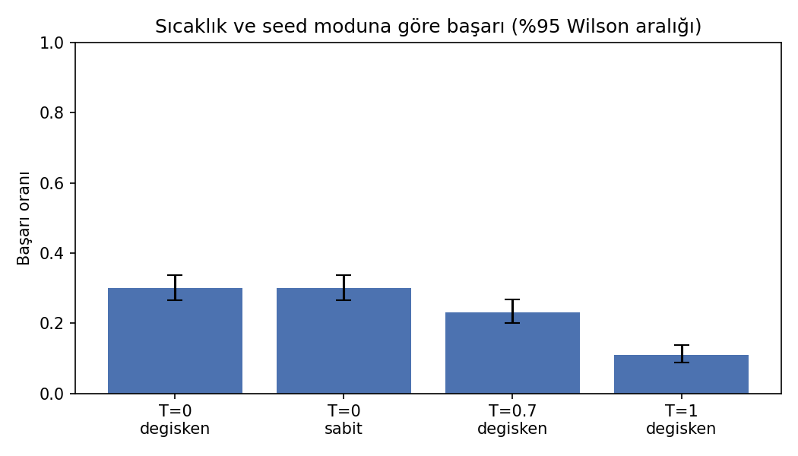
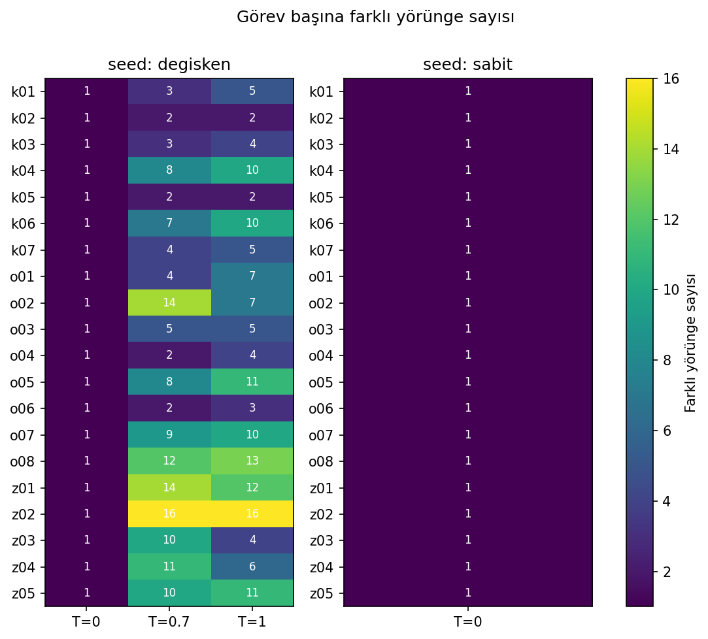

# LLM Ajanlarında Tekrarlı Koşu Değişkenliği (Pilot)

> Bu bir pilot çalışmadır. Küçük bir açık modelle, kontrollü ve basit bir görev kümesinde yapılmıştır; sonuçlar büyük modellere veya gerçek ajan kıyaslama setlerine doğrudan genellenemez.

Aynı araç çağırma (tool calling) görevi küçük bir açık modelle tekrar tekrar koşturulur. Ölçülen şey, sonuçların ve izlenen adımların (yörünge) koşudan koşuya ne kadar değiştiğidir. Sıcaklık 0'da bile değişkenlik olup olmadığı ve güvenilir bir başarı oranı için kaç tekrar gerektiği sorulur.

## Araştırma soruları

- **S1.** Sıcaklık 0'da aynı görev 30 koşuda aynı sonucu ve aynı yörüngeyi veriyor mu?
- **S2.** Sıcaklık arttıkça (0 / 0.7 / 1.0) başarı oranı ve yörünge çeşitliliği nasıl değişiyor?
- **S3.** Tek koşuyla raporlanan başarı oranı, 30 koşunun güven aralığından ne kadar sapıyor?
- **S4 (ek).** Sıcaklık 0'da batch boyutu (1 ve 8) çıktıyı değiştiriyor mu?

## Kurulum

| | |
|---|---|
| Model | `Qwen/Qwen2.5-1.5B-Instruct` (float16) |
| Araçlar | `hesapla(ifade)`, `birim_cevir(deger, kaynak, hedef)`, `sozluk_ara(anahtar)` (hepsi deterministik) |
| Görevler | 20 görev: 7 kolay (1 adım), 8 orta (2 adım), 5 zor (3+ adım), `tasks/tasks.json` |
| Deney | T=0: seed {sabit=42, değişken} × 30 koşu (1200) · T=0.7 ve T=1.0: değişken seed × 30 koşu (1200) → 2400 koşu |
| S4 | T=0, sabit seed, batch=8 × 30 koşu (600) |
| Başarı | Nihai cevaptaki bir sayının doğru cevaba %0.5 göreli toleransla eşit olması |

Başlangıç planı tüm sıcaklıklarda iki seed modu ve 30 koşuydu (3600 koşu). T=0.7'de sabit seed ile ilk 229 koşunun her görevde birebir aynı çıktığı görülünce (seed her koşuda sıfırlandığı için örnekleme aynı sayıları çeker) T>0 için sabit seed blokları bırakıldı ve deney 2400 koşuyla tamamlandı. Bu 229 koşu `results/runs_t07_sabit_seed.jsonl` dosyasında ayrıca saklanır.

Sıcaklık 0, açgözlü çözümleme (`do_sample=False`) demektir. Sıcaklık > 0'da `top_p=1`, `top_k=0` ile saf örnekleme yapılır. `sozluk_ara` aracındaki değerler deney için sabitlenmiş yaklaşık değerlerdir ve güncel istatistik iddiası taşımaz.

## Ölçülen metrikler

- Başarı oranı, görev bazında ve genel, %95 Wilson güven aralığıyla
- Farklı yörünge sayısı (araç adı ve argümanlarıyla birlikte benzersiz araç çağrı dizileri)
- İlk sapma adımı: koşuların ilk kez farklı adım attığı adım
- Kararsız (flaky) görevler: bazı koşularda başarılı, bazılarında başarısız olanlar
- Üretilen token ve süre değişkenliği
- Tek koşu yanılgısı: her görevden rastgele tek koşu seçildiğinde (2000 bootstrap) başarı oranının 30 koşu ortalamasından sapması

## Kullanım

```bash
pip install -r requirements.txt
python -m pytest -q tests                      # modelsiz birim testleri

# raporlanan deney (2400 koşu) -> results/runs.jsonl
python src/runner.py --temps 0 --runs 30
python src/runner.py --temps 0.7 1.0 --seed-modes degisken --runs 30

python src/runner.py --runs 30                 # başlangıçtaki tam plan (3600 koşu)
python src/runner.py --limit 10 --temps 0 0.7  # kısaltılmış sürüm
python src/runner.py --temps 0 --seed-modes sabit --batch-size 8 \
    --out results/runs_batch8.jsonl            # S4

python src/analysis.py --batch results/runs_batch8.jsonl
```

Koşu yarıda kesilirse aynı komut tekrar çalıştırılabilir, kayıtlı koşular atlanır. Colab için: `notebooks/colab_demo.ipynb`.

Her koşu `runs.jsonl` içinde bir satırdır: görev, sıcaklık, seed, koşu no, batch boyutu, araç adımları ve gözlemler, nihai cevap, başarı, üretilen token ve süre.

## Sonuçlar

Ortam: NVIDIA GeForce RTX 4070 Laptop (8 GB), sürücü 592.82, CUDA 13.0, torch 2.14.0, transformers 5.19.0, Python 3.10.11, Windows 11. Ayrıntılı yorum için [RAPOR.md](RAPOR.md).

| Sıcaklık | Seed | Koşu | Başarı [%95 Wilson] | Ort. farklı yörünge | Kararsız görev | Tek koşu, CI dışı |
|---|---|---|---|---|---|---|
| 0 | sabit | 600 | 0.300 [0.265, 0.338] | 1.0 | 0/20 | 0.000 |
| 0 | değişken | 600 | 0.300 [0.265, 0.338] | 1.0 | 0/20 | 0.000 |
| 0.7 | değişken | 600 | 0.232 [0.200, 0.267] | 7.3 | 12/20 | 0.418 |
| 1.0 | değişken | 600 | 0.110 [0.087, 0.138] | 7.35 | 9/20 | 0.668 |

**S1.** Evet. T=0'da 20 görevin hepsinde 30 koşu aynı yörüngeyi ve aynı nihai cevabı verdi. Seed modu (sabit ya da değişken) sonucu hiç değiştirmedi.

**S2.** Sıcaklık arttıkça başarı düştü (0.300 → 0.232 → 0.110) ve her görevde birden fazla yörünge ortaya çıktı (görev başına 2 ile 16 arası, en fazla z02). T>0'da koşular her görevde ilk adımda ayrışıyor. Düşüşün ana nedeni, modelin hiç araç çağırmadan doğrudan cevap vermesi: bu oran kolay görevlerde T=0'da %0, T=0.7'de %16, T=1.0'da %46. Buna karşılık T=0'da hiç çözülemeyen 7 görev (o02, o03, o07, o08, z01, z02, z04) T>0'da en az bir koşuda çözüldü.

**S3.** Her görevden tek koşu alınarak hesaplanan başarı oranı T=0.7'de ortalama 5.1, en kötü durumda 18.2 yüzde puan saptı. Bootstrap örneklerinin %42'si 600 koşunun güven aralığının dışında kaldı; bu oran T=1.0'da %67. Görev başına ortalama Wilson aralığı genişliği 30 koşuda bile 0.18–0.20. T=0'da tek koşu yeterli, çünkü koşular arasında fark yok.

**S4.** T=0'da batch=8, 20 görevin 19'unda batch=1 ile aynı yörüngeyi verdi. k04'te 8'lik gruplar `birim_cevir(3, saat, saniye)` çağırırken batch=1 ve son 6'lık grup `hesapla("3 * 3600")` çağırdı. Nihai cevap ve başarı her iki durumda da aynı kaldı.

| Çıktı | Dosya |
|---|---|
| Sıcaklığa göre başarı + güven aralığı | `results/1_basari_sicaklik.png` |
| Görev × sıcaklık farklı yörünge sayısı | `results/2_yorunge_isi_haritasi.png` |
| Kararsız görev oranı | `results/3_kararsiz_gorevler.png` |
| Kaç tekrar yeterli? | `results/4_tekrar_sayisi_ci.png` |
| Görev bazında metrikler | `results/gorev_metrikleri.csv` |
| Genel metrikler | `results/genel_metrikler.csv` |
| Tek koşu yanılgısı | `results/tek_kosu_yanilgisi.csv` |
| Hata türleri (sıcaklık × zorluk) | `results/hata_turleri.csv` |
| S4 karşılaştırması | `results/s4_batch_karsilastirma.csv` |




## Sınırlılıklar

- Tek ve küçük bir model (1.5B), 20 yapay görev. Görevler kasıtlı olarak kısa ve cevabı kesin bilinen türdendir.
- Başarı kontrolü sayı eşleştirmesine dayanır. Cevapta ara bir değer doğru cevapla çakışırsa yanlış pozitif oluşabilir.
- Batch > 1 iken seed batch başına bir kez ayarlanır ve süre batch içindeki koşulara eşit bölünür. 30 koşu 8'e tam bölünmediği için S4'teki son grup 6 koşuluktur.
- Görev bazındaki başarı tahminleri 30 koşuda da geniş aralıklıdır (T>0'da ortalama Wilson genişliği ~0.19).
- Deneyin bir kısmında aynı GPU'da başka işler de çalıştığı için süre ölçümleri karşılaştırma amaçlı kullanılmamalıdır. Token sayıları bundan etkilenmez.
- Model T=0'da görevlerin yalnızca %30'unu çözüyor ve orta/zor görevlerin hiçbirini çözemiyor. Kararsızlık analizi bu yüzden pratikte kolay görevlerle sınırlı kalıyor.
- Sıcaklık 0'daki olası farklar donanıma, CUDA çekirdeklerine ve kütüphane sürümlerine bağlıdır; sonuçlar kullanılan GPU ile birlikte raporlanmalıdır.

## Repo yapısı

```
tasks/tasks.json         20 görev, doğru cevaplar ve referans yörüngeler
src/tools.py             3 araç ve JSON şemaları
src/agent.py             ajan döngüsü (batch destekli)
src/runner.py            tekrarlı koşu, jsonl kayıt, başarı kontrolü
src/analysis.py          metrikler, csv tablolar, grafikler
tests/test_core.py       modelsiz birim testleri
notebooks/colab_demo.ipynb
results/                 runs.jsonl, runs_batch8.jsonl, csv ve png çıktıları, koşu logları
RAPOR.md                 yöntem, bulgular ve sınırlılıklar
```
